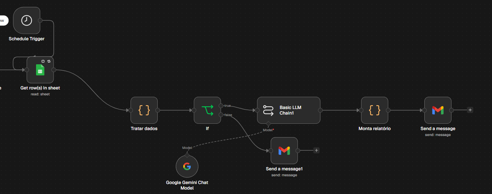
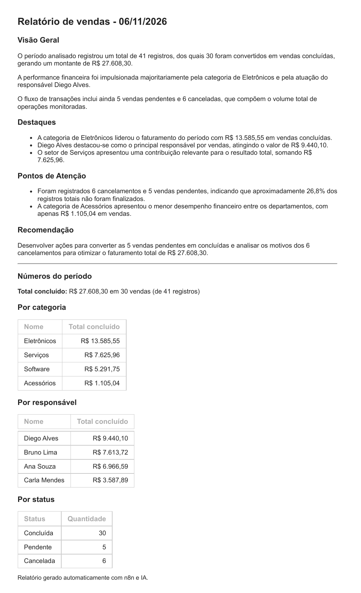
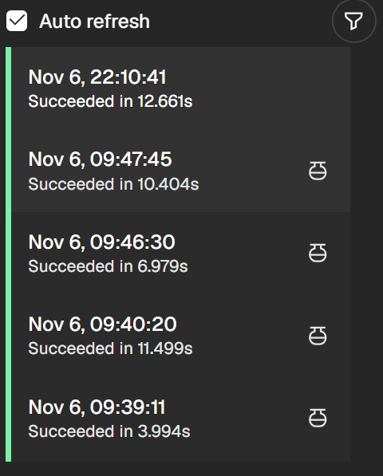
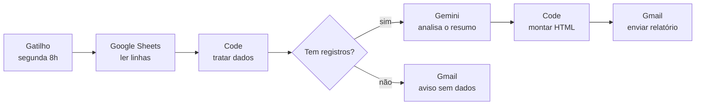
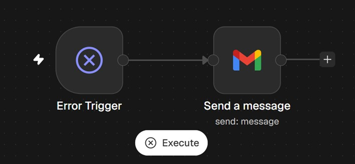

# Automação de relatório de vendas com n8n e IA

Workflow que lê uma planilha de vendas no Google Sheets, calcula os totais, pede a uma IA (Google Gemini) uma análise em texto e envia por e-mail, toda segunda-feira às 8h, um relatório em HTML com a análise e as tabelas de números.

## O problema

Montar um relatório semanal à mão significa abrir a planilha, somar, agrupar, escrever a análise e enviar. É repetitivo e fácil de errar. Este projeto automatiza o processo inteiro e trata os casos em que algo dá errado (planilha vazia, falha de API ou de autorização).

## Resultado



O e-mail recebido tem a análise escrita pela IA (visão geral, destaques, pontos de atenção e recomendação) e três tabelas calculadas pelo código: total por categoria, total por responsável e quantidade por status.



A aba de execuções mostra o disparo automático pelo agendamento:



## Como funciona



| Etapa | Node | O que faz |
|---|---|---|
| 1 | Schedule Trigger | Dispara toda segunda às 8h. Há também um gatilho manual para testes. |
| 2 | Google Sheets | Lê as linhas da aba `dados` (data, categoria, responsavel, valor, status). |
| 3 | Code (Tratar dados) | Soma só as vendas concluídas, agrupa por categoria e responsável e conta os status. |
| 4 | If | Se não houver registros, envia um aviso em vez do relatório. |
| 5 | Basic LLM Chain + Gemini | Recebe o resumo e escreve a análise em HTML simples. |
| 6 | Code (Monta relatório) | Junta a análise da IA com as tabelas de números em HTML. |
| 7 | Gmail | Envia o relatório. |

## Decisões de projeto

- **A IA recebe só o resumo, não a planilha.** Fica mais barato, mais rápido e reduz o risco de erro de leitura.
- **Os números exatos vêm do código, não da IA.** As tabelas são calculadas em JavaScript. A IA só escreve o texto, com a instrução de usar apenas os dados fornecidos e temperatura baixa (0,3).
- **Validação manual da saída.** Em uma execução de teste, comparei os valores citados no texto (totais por categoria, melhor vendedor, quantidade de cancelamentos e pendências) com o resumo calculado, e todos bateram. A IA também calculou uma porcentagem derivada (registros não finalizados), e o valor estava correto.
- **Tratamento de erros:**
  - *Retry on Fail* (3 tentativas) nos nodes que dependem de internet.
  - Planilha vazia gera um e-mail de aviso, em vez de falha silenciosa.
  - Um segundo workflow (`Aviso de erro`) usa o Error Trigger e manda um e-mail com o nome do node e a mensagem de erro quando uma execução agendada falha.



## Como rodar

### Pré-requisitos
- Docker Desktop
- Conta Google com Gmail (o node Gmail só envia por conta com caixa de e-mail)
- Projeto no Google Cloud com as APIs **Google Sheets**, **Google Drive** e **Gmail** ativadas, e um cliente OAuth do tipo "Aplicativo da Web"
- Chave de API do Google Gemini (Google AI Studio)

### 1. Subir o n8n

```bash
docker volume create n8n_data

docker run -d --name n8n --restart unless-stopped -p 5678:5678 \
  -e GENERIC_TIMEZONE="America/Recife" -e TZ="America/Recife" \
  -v n8n_data:/home/node/.n8n \
  docker.n8n.io/n8nio/n8n
```

Acesse `http://localhost:5678` e crie sua conta local.

### 2. Preparar a planilha
Importe `dados/dados_relatorio.xlsx` no Google Sheets. A aba deve se chamar `dados`, e os cabeçalhos devem ser exatamente `data`, `categoria`, `responsavel`, `valor` e `status`.

### 3. Importar os workflows
No n8n, use **Import from File** com `workflow/aviso-de-erro.json` e depois `workflow/relatorio-semanal-ia.json`.

### 4. Configurar credenciais
- **Google Sheets** e **Gmail** (OAuth2): use o Client ID e o Client Secret do seu projeto. A URL de redirecionamento é `http://localhost:5678/rest/oauth2-credential/callback`.
- **Google Gemini**: cole a chave de API.
- No node **Get row(s) in sheet**, troque `SEU_ID_DA_PLANILHA` pelo ID da sua planilha (o trecho da URL entre `/d/` e `/edit`).
- Nos nodes **Gmail**, troque `example@gmail.com` pelo seu e-mail.

### 5. Ligar o aviso de erro e publicar
1. Publique o workflow `Aviso de erro`.
2. No workflow principal: **⋯ → Settings → Error Workflow** e escolha `Aviso de erro`.
3. Publique o workflow principal.

## Estrutura do repositório

```
├── README.md
├── workflow/
│   ├── relatorio-semanal-ia.json
│   └── aviso-de-erro.json
├── dados/
│   └── dados_relatorio.xlsx
└── imagens/
```

Os dados do exemplo são fictícios (40 registros). O e-mail mostrado acima vem de um teste com 41 registros: os 40 do arquivo mais um adicionado manualmente.

## Limitações conhecidas

- O n8n só dispara o agendamento enquanto o container estiver ligado, então o computador precisa estar ligado com o Docker em execução.
- Com o app do Google Cloud em modo **Teste**, a autorização OAuth costuma expirar em cerca de 7 dias, e as credenciais do Sheets e do Gmail precisam ser reconectadas. O workflow de aviso de erro existe, em parte, para sinalizar isso.
- O relatório considera todos os registros da planilha, sem filtrar por período.

## Melhorias futuras

- Filtrar os registros pela semana corrente.
- Comparar a semana atual com a anterior.
- Gerar um gráfico e anexá-lo ao e-mail.
- Hospedar o n8n em um servidor para não depender do computador local.

## Tecnologias

n8n · Docker · Google Sheets · Google Gemini · Gmail · JavaScript
